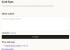
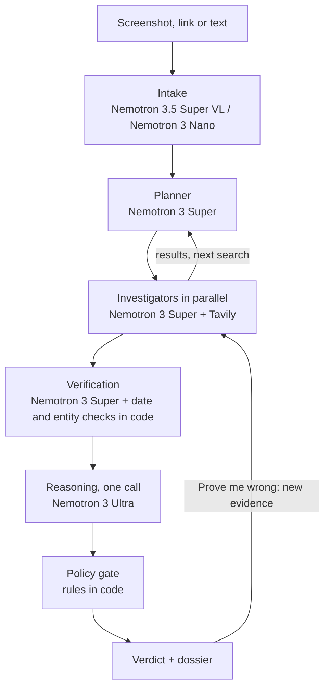

# Crab Eyes

> *Ojú l'alákàn fi ń ṣọ́ rí* — the crab guards its head with its eyes. (Yoruba proverb)

**Forward any investment offer, and Crab Eyes investigates it like an analyst: it checks the scheme's claims against official records, does the maths, vets every source, and gives a cited verdict before you send money.**

Built for the **Nebius x NVIDIA Global AI Hackathon** (Best Apps and Agents track) with **NVIDIA Nemotron models on Nebius Token Factory** and **Tavily**.

- **Video (under 3 minutes):**

[](https://youtu.be/LzxBUc1TDOc)

---

## The problem

In April 2025, CBEX, a platform that promised to double people's money in 30 days through "AI trading", froze withdrawals in Nigeria. The regulator's general warning came after the collapse. Since then the SEC has kept warning about schemes promoted on WhatsApp, Telegram, Instagram and TikTok, and told the public to verify registration before investing.

People hear about these schemes in family group chats, not on regulators' websites. Crab Eyes brings the regulator's records, the maths and the public evidence to the message they already have.

## What it does

1. **Forward a pitch**: a screenshot, a link or pasted text.
2. **Watch it investigate**: it reads the claims, plans which checks to run, and goes after the evidence still missing.
3. **Get a verdict** with the top reasons and a full dossier:
   - **Claims vs. records**: what the pitch says about itself beside what official sources say.
   - **Ponzi maths**: the promised return as a yearly figure, calculated in code.
   - **Competing explanations**: licensed and legitimate, real but unlicensed, Ponzi or fraud, or impersonation, each with a probability.
   - **Every source**, including the ones it checked and set aside, and why.
4. **Prove me wrong**: the agent says what evidence would change its mind; supply it and the investigation reruns.

### Four verdicts, decided by rules in code, not by the model

| Verdict | Shown only when |
| --- | --- |
| **High risk** | Two or more independent verified red flags, one of them official; or the promised return fails the maths plus one more red flag |
| **Check first** | At least one verified red flag, but not enough for High risk |
| **Looks legitimate** | A confirmed match on an official register, with matching details |
| **Not enough evidence** | Too little verified evidence to judge |

Crab Eyes never calls a named company a scam. It shows a rating and the evidence.

## How it works



The five investigators:

| Check | What it does |
| --- | --- |
| Regulator | Searches SEC Nigeria, CBN and FCCPC sites; a licence claim with no record found is a red flag |
| Ponzi maths | Compounds the promised return in code and compares it with Treasury-bill rates |
| Footprint | Company registration and website facts; scheme sites are fetched through Tavily, never opened directly |
| People | Searches named promoters (full names only) |
| Voices | Looks for scam patterns: blocked withdrawals, "withdrawal fees", collapse, regulator action |

## How I use NVIDIA Nemotron and Nebius Token Factory

Every model call goes through the **Nebius Token Factory** OpenAI-compatible API. Each step uses the cheapest model that does it well; the routing is in [`routing.yaml`](routing.yaml).

| Step | Model on Token Factory |
| --- | --- |
| Read screenshots | `nvidia/Nemotron-3.5-Super-VL` |
| Extract claims from text | `nvidia/NVIDIA-Nemotron-3-Nano-30B-A3B` |
| Planner, five investigators, verification | `nvidia/nemotron-3-super-120b-a12b` |
| Final reasoning (once per dossier) | `nvidia/Nemotron-3-Ultra-550b-a55b` |

Every dossier includes a trace of each model call with its tokens and cost. Model IDs are checked against Token Factory's `/v1/models` at start-up.

TODO: if deployed, add a line here on the Nebius Serverless Endpoint or Job; otherwise delete this line.

## How I use Tavily

- **Search**, limited to official domains for the regulator check, and to news with an `end_date` for historical re-runs.
- **Extract** to read a scheme's website without opening it from our server.
- Every Tavily call appears in the dossier trace with its query, the sites searched and the number of results.

## Results

### Evaluation: 13 cases (`evals/cases.csv`, results in `evals/results/routed.json`)

4 real schemes named by SEC Nigeria or the press, 3 real legitimate products (a registered fund manager's fund, FGN Savings Bonds, Treasury Bills) and 6 synthetic cases, clearly labelled.

| Measure | Result |
| --- | --- |
| Legitimate products marked High risk | **0** |
| High risk verdicts that were correct | **100%** |
| Real schemes flagged High risk | **4 of 4** |
| All scams flagged High risk | 7 of 8 |
| Median time per investigation | 39 seconds |
| Average model cost per investigation | **$0.011** |

Legitimate products came back "Check first" or "Not enough evidence", never High risk. Crab Eyes only says "Looks legitimate" when an official register confirms it, and model calls vary slightly between runs.

### The CBEX re-run (`evals/cbex_rerun/`)

I asked Crab Eyes to investigate CBEX using only sources published on or before **9 April 2025**, the day before withdrawals froze.

- **Verdict: Check first.** "100% a month compounds to 409,500% a year."
- Little else had been published before the collapse.
- Tavily's `end_date` filter still returned five post-collapse articles. Crab Eyes's own date check rejected every one, plus undated pages and older pages whose text mentions later years, so no post-collapse knowledge reached the verdict.

## Limitations

- Crab Eyes searches the SEC's website; it does not query the SEC register database directly (there is no public API). "Not found" means *not found in searches*, which is why "Prove me wrong" exists.
- Fixed-payout pitches ("₦15,000 a day") are not yet converted into a return rate, so the maths check misses them.
- A pitch with no company name cannot be checked against the register.
- Model outputs vary between runs; the policy gate keeps verdicts conservative.

## Next

Telegram bot; opt-in "you've seen this before" memory; a nightly job that stores the SEC's list of registered operators and builds a public early-warning ledger.

## Run it yourself

Requirements: Python 3.12+, [uv](https://docs.astral.sh/uv/), Docker, a Nebius Token Factory API key and a Tavily API key.

```bash
git clone https://github.com/subair99/crab-eyes && cd crab-eyes
uv sync
cp .env.example .env        # add TOKEN_FACTORY_API_KEY, TAVILY_API_KEY and BENCHMARK_ANNUAL_RATE
docker compose up -d db
uv run pytest
uv run --env-file .env uvicorn app.main:app --reload
```

Open http://localhost:8000, paste a pitch or upload a screenshot, and click **Investigate**.

Evaluations and the CBEX re-run:

```bash
uv run --env-file .env python -m evals.run_evals
uv run --env-file .env python -m evals.cbex_rerun.run
```

## Feedback on the tools

See [`docs/feedback.md`](docs/feedback.md).

## License

MIT. See [LICENSE](LICENSE).

*Crab Eyes shows evidence, not financial advice. "High risk" is a rating, not a legal finding.*
